# FinSim: Learn the Market, and the People Trying to Trick You

**Get scammed here, so you never get scammed out there.**

FinSim is a free, browser-based platform where students, first-time investors and senior citizens **practise** financial decisions and **rehearse** real scams with simulated money, before it happens for real.

> **Live prototype:** https://ayediti.github.io/cdsl-ideathon/
> **Built for:** CDSL Reimagine Ideathon 2027
> **Team Flintech, IIT Kharagpur:** Aditi Choudhary, Harshil Agarwal · Mentor: Prof. Debashish Chakravarty

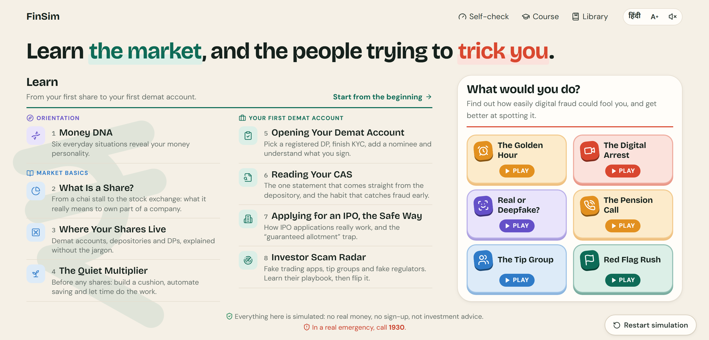

---

## Contents

1. [The problem](#the-problem)
2. [Our insight](#our-insight)
3. [What FinSim is: two doors](#what-finsim-is-two-doors)
4. [Door A: six scam games](#door-a-six-scam-games)
5. [Door B: the investor course](#door-b-the-investor-course)
6. [The virtual phone](#the-virtual-phone)
7. [Who it is for](#who-it-is-for)
8. [Inclusion and accessibility](#inclusion-and-accessibility)
9. [Privacy and safety by design](#privacy-and-safety-by-design)
10. [Measuring impact](#measuring-impact)
11. [How FinSim maps to the judging criteria](#how-finsim-maps-to-the-judging-criteria)
12. [Roll-out plan](#roll-out-plan)
13. [Technology and architecture](#technology-and-architecture)
14. [Repository layout](#repository-layout)
15. [Run it locally](#run-it-locally)
16. [Deploy to GitHub Pages](#deploy-to-github-pages)
17. [Extend it](#extend-it)
18. [The submission paper](#the-submission-paper)
19. [Disclaimer](#disclaimer)

---

## The problem

India is adding investors faster than it is adding *informed* investors. From the CDSL problem statement:

| Signal | Figure |
|---|---|
| Households investing in securities | ~3.21 crore of 33.72 crore (**~9.5%**), though 63% know at least one product |
| Participation in SEBI investor education programmes | **below 1%**, yet 91% of past participants rate them highly useful |
| Non-investors who cite trust as a key barrier | **51%** |
| Households that are risk-averse | ~80% (79% of Gen Z households) |
| Demat accounts from Tier II+ cities | **80%**, while only ~20% belong to women |
| Financial literacy, ages 18–29 (NCFE survey) | Lower than older cohorts |

Meanwhile, fraudsters reach people directly through WhatsApp groups, video calls, cloned voices and fake trading apps. Cyber fraud hits hardest those least familiar with digital risk signals: seniors, students and new investors.

**The gap is reach, not value.** Investor education works when people take it; most people never do.

## Our insight

> People do not lack information; they lack **rehearsal**.
> Nobody reads a circular in the middle of a "police" video call.

FinSim lets people live through that moment, and dozens like it, in a safe simulation: they make a choice, see the consequence on virtual money, and learn exactly which tactic was used on them. This follows the "inoculation" research behind games like *Bad News* and *Go Viral!* (University of Cambridge), which showed that playing through a manipulation builds resistance to it. FinSim applies the idea to securities markets and investor fraud.

---

## What FinSim is: two doors

| | **A. Scam games** | **B. Investor course** |
|---|---|---|
| Role | The **hook**: reach | The **depth**: literacy |
| Length | ~2–3 minutes each | 8 chapters, 54 interactive screens |
| Entry | A link you can forward on WhatsApp | Start at any chapter |
| Format | Realistic chat, call, video or feed | Story-driven simulation with virtual money and a virtual phone |
| Ends with | Score, choice-by-choice review, red flags, real-world response steps, share bar | Recap, financial health score, XP |
| Route | `/arcade/:gameId` | `/learn` → `/play/:module/:chapter/:screen` |

Everything inside is simulated: fictional companies, fictional banks and brokers, virtual money, no real accounts.

---

## Door A: six scam games

| Game | What the player practises | Audience | Time |
|---|---|---|---|
| **The Digital Arrest** | Getting off a fake "Cyber Crime Branch" video call that claims you are under arrest | Seniors, students, first-time investors | 3 min |
| **The Pension Call** | Refusing an OTP-based "life certificate" call (the OTP actually says *add beneficiary*) | Seniors | 2 min |
| **Real or Deepfake?** | Judging seven clips and messages: cloned voices, fake celebrity ads, fake SEBI notices | Everyone | 3 min |
| **The Tip Group** | Resisting a "VIP stock tips" pump-and-dump group | Students, first-time investors | 3 min |
| **Red Flag Rush** | Tapping every red flag in three investor scams (IPO, fake app, KYC) in 75 seconds | Students, first-time investors | 2 min |
| **The Golden Hour** | Spending the first 60 minutes after a fraud well: every action costs minutes | Everyone | 2 min |

<table>
  <tr>
    <td>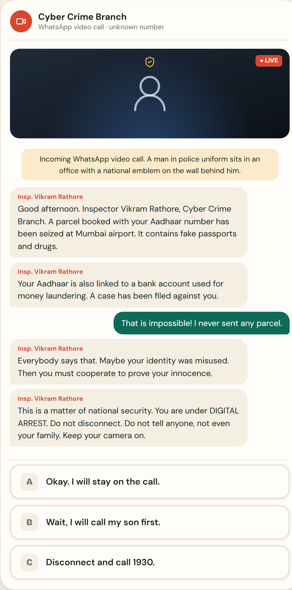</td>
    <td>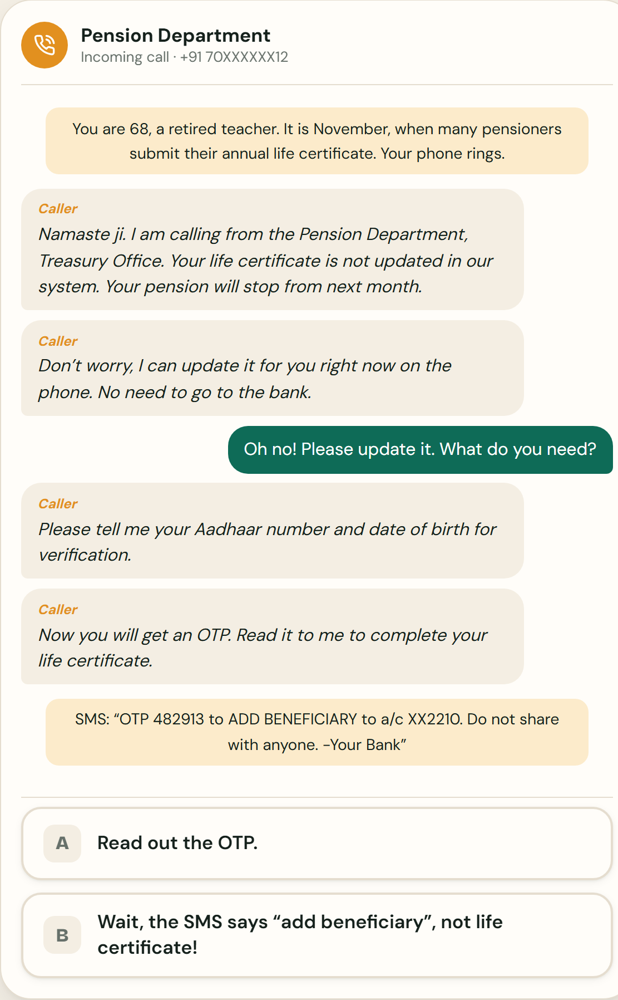</td>
    <td>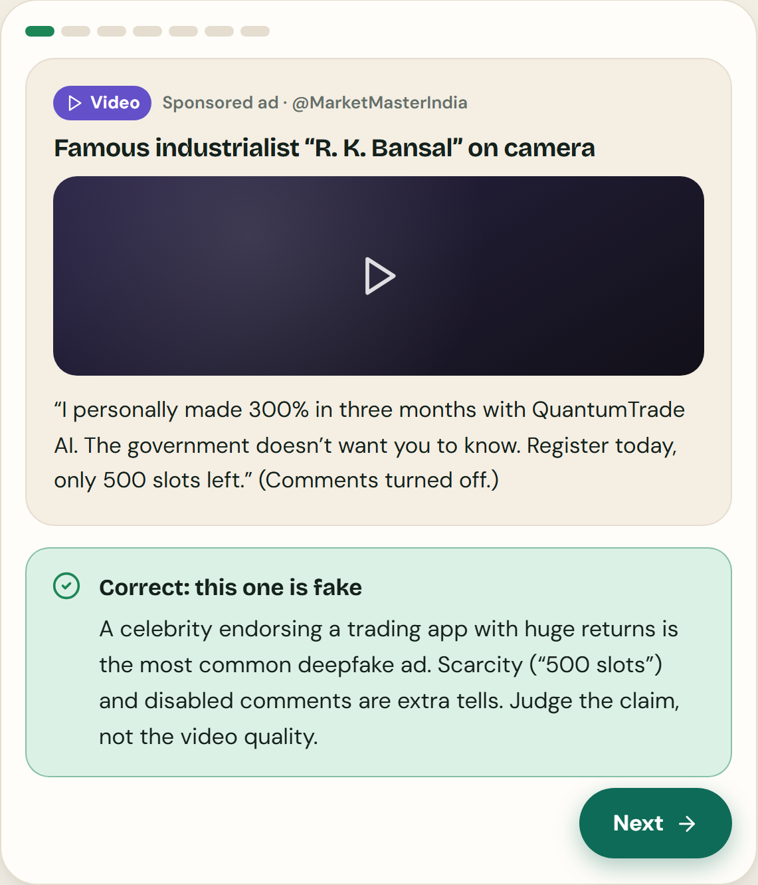</td>
  </tr>
  <tr>
    <td align="center"><sub>The Digital Arrest</sub></td>
    <td align="center"><sub>The Pension Call</sub></td>
    <td align="center"><sub>Real or Deepfake?</sub></td>
  </tr>
  <tr>
    <td>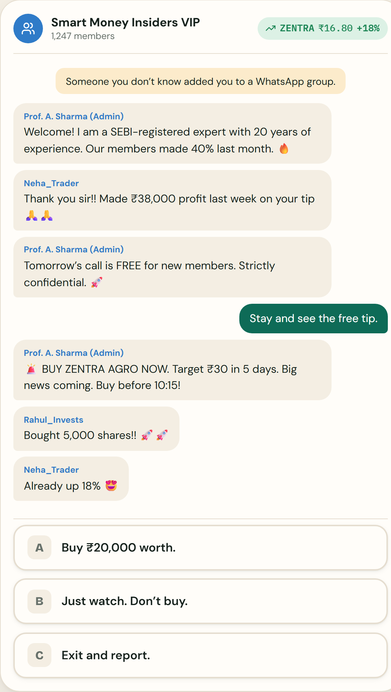</td>
    <td>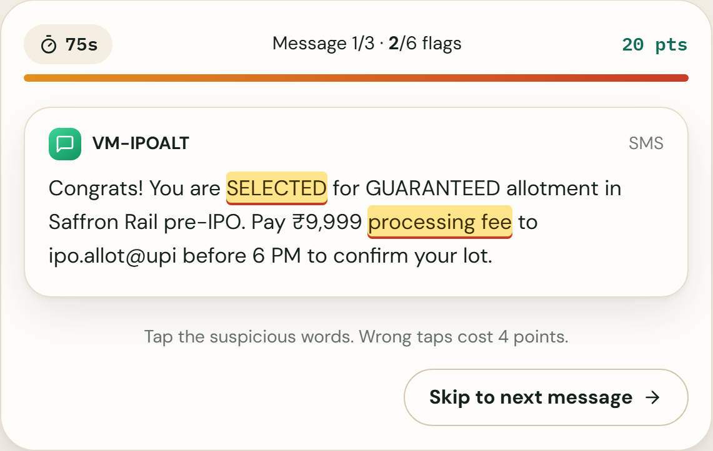</td>
    <td>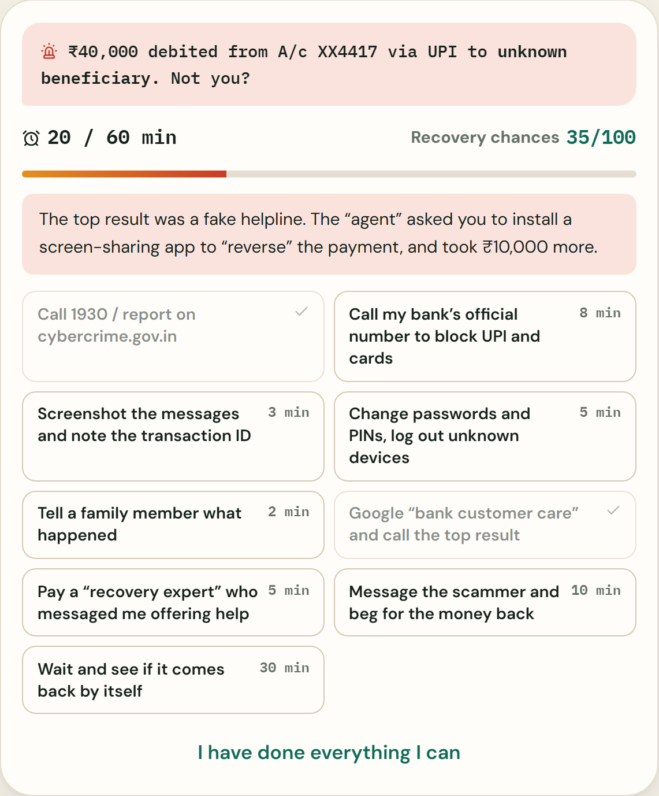</td>
  </tr>
  <tr>
    <td align="center"><sub>The Tip Group</sub></td>
    <td align="center"><sub>Red Flag Rush</sub></td>
    <td align="center"><sub>The Golden Hour</sub></td>
  </tr>
</table>

### How a round plays

1. One situation at a time, one decision at a time.
2. The story reacts: the fake officer pushes harder, a share price climbs, the clock runs down.
3. Choices cost or earn **points, never real money**. Several endings per game, from "Off the call in under a minute" to "₹6,50,000 gone".
4. Every game ends in a **debrief**:
   - a score from 0–100, labelled *Hooked*, *Shaky*, *Sharp* or *Scam-proof*;
   - a review of each choice;
   - the red flags, explained;
   - **"If this happens for real"** steps: call **1930**, report at **cybercrime.gov.in**, call your bank on its official number, freeze your demat or trading account, and complain on **SEBI SCORES**;
   - a **share bar** ("I scored 80, can you?"). The link carries only the game's id, never a score history or identity.

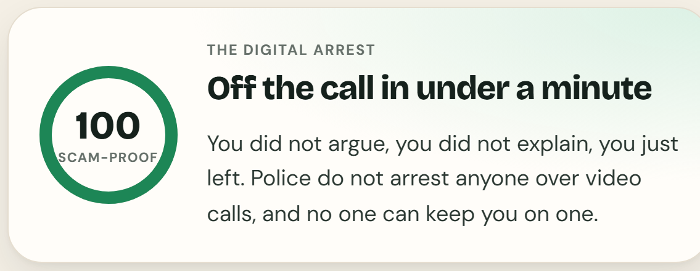

Best scores are kept per browser only. There is no leaderboard and no account.

---

## Door B: the investor course

Three modules, eight chapters, **54 interactive screens**. Every chapter **teaches through interaction first** (explore cards, sorting, sequencing, hands-on labs) and only then quizzes. Learners can open any chapter directly. If a chapter depends on earlier ones (for example, it needs shares already in the demat account), it quietly sets that up on entry.

| Module | Chapter | Screens | Concept → interaction |
|---|---|---|---|
| **Orientation** | Money DNA | 4 | Your money personality → six-situation scenario quiz with a shareable result |
| **Market Basics** | What Is a Share? | 7 | Owning vs lending, why prices move → sort, **price lab** |
| | Where Your Shares Live | 7 | Bank vs trading vs demat account, depositories (CDSL/NSDL), DPs → sequence a trade |
| | The Quiet Multiplier | 6 | Emergency cushion, compounding → **compounding slider lab**, set up a recurring deposit |
| **Your First Demat Account** | Opening Your Demat Account | 10 | SEBI registration, KYC, nominee, DDPI/TPIN → verify a broker on the phone |
| | Reading Your CAS | 6 | Anatomy of the Consolidated Account Statement → catch an unauthorised transfer |
| | Applying for an IPO, the Safe Way | 7 | ASBA, UPI mandate, the allotment lottery → legit-or-scam sort |
| | Investor Scam Radar | 7 | Fake trading apps, tip groups, fake regulators → scam autopsy, then flip the playbook |

<table>
  <tr>
    <td>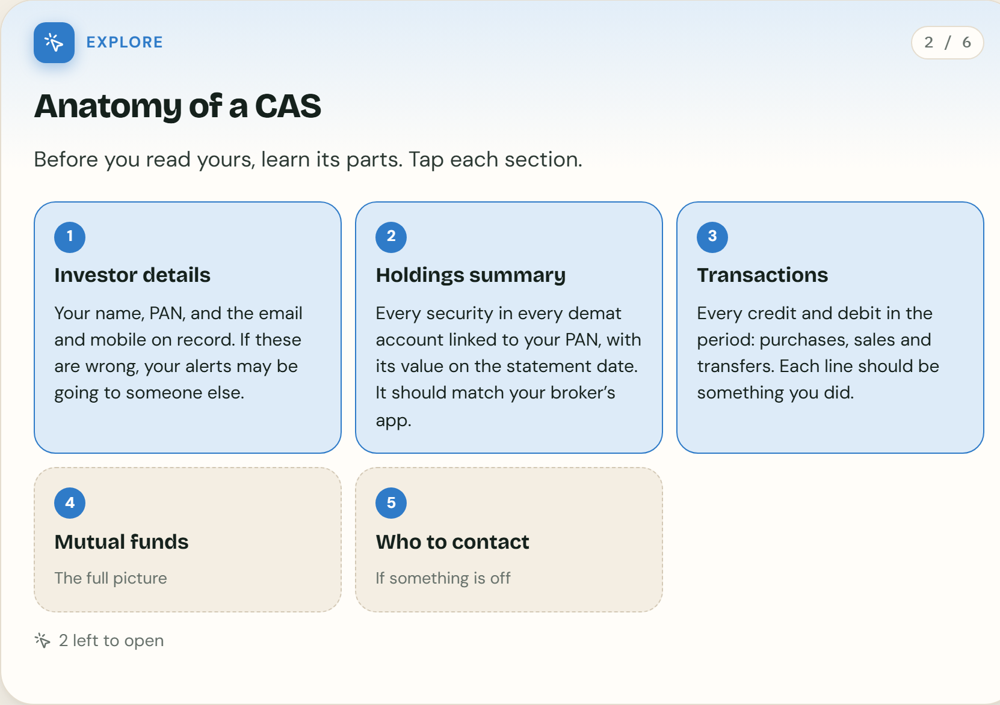</td>
    <td>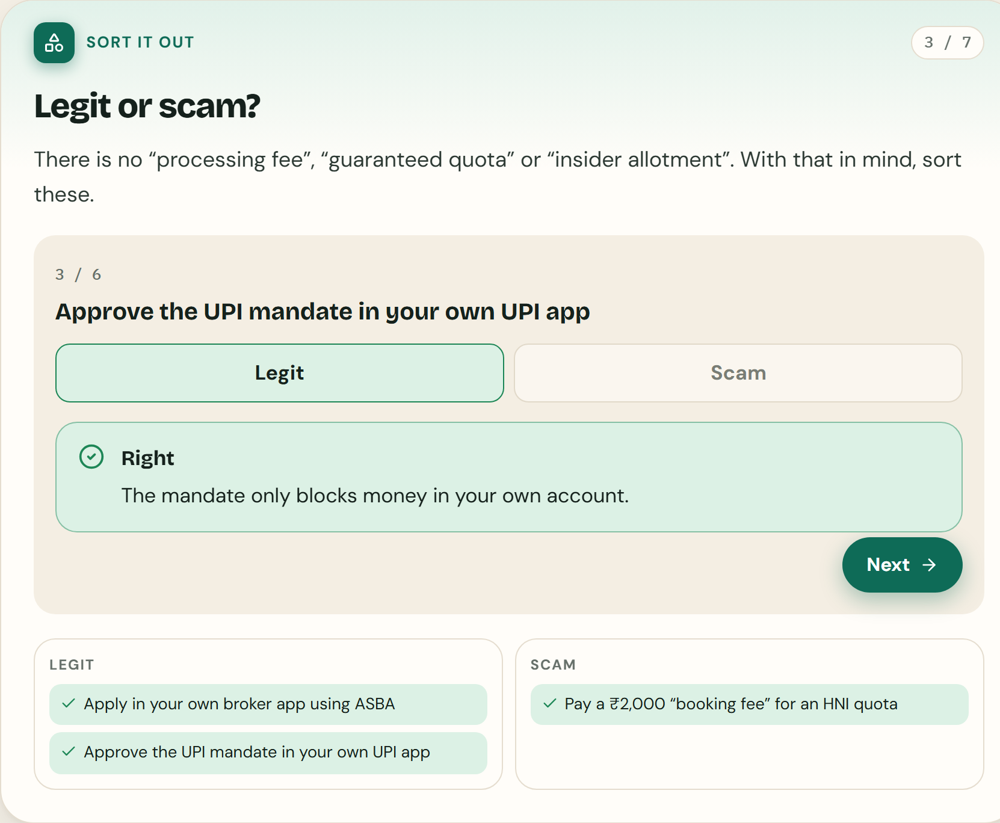</td>
  </tr>
  <tr>
    <td align="center"><sub>Explore: tap each part of a CAS</sub></td>
    <td align="center"><sub>Sort: legit or scam, with instant feedback</sub></td>
  </tr>
  <tr>
    <td>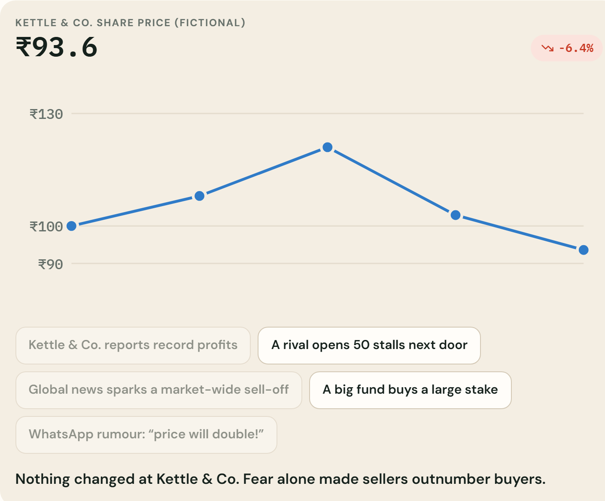</td>
    <td>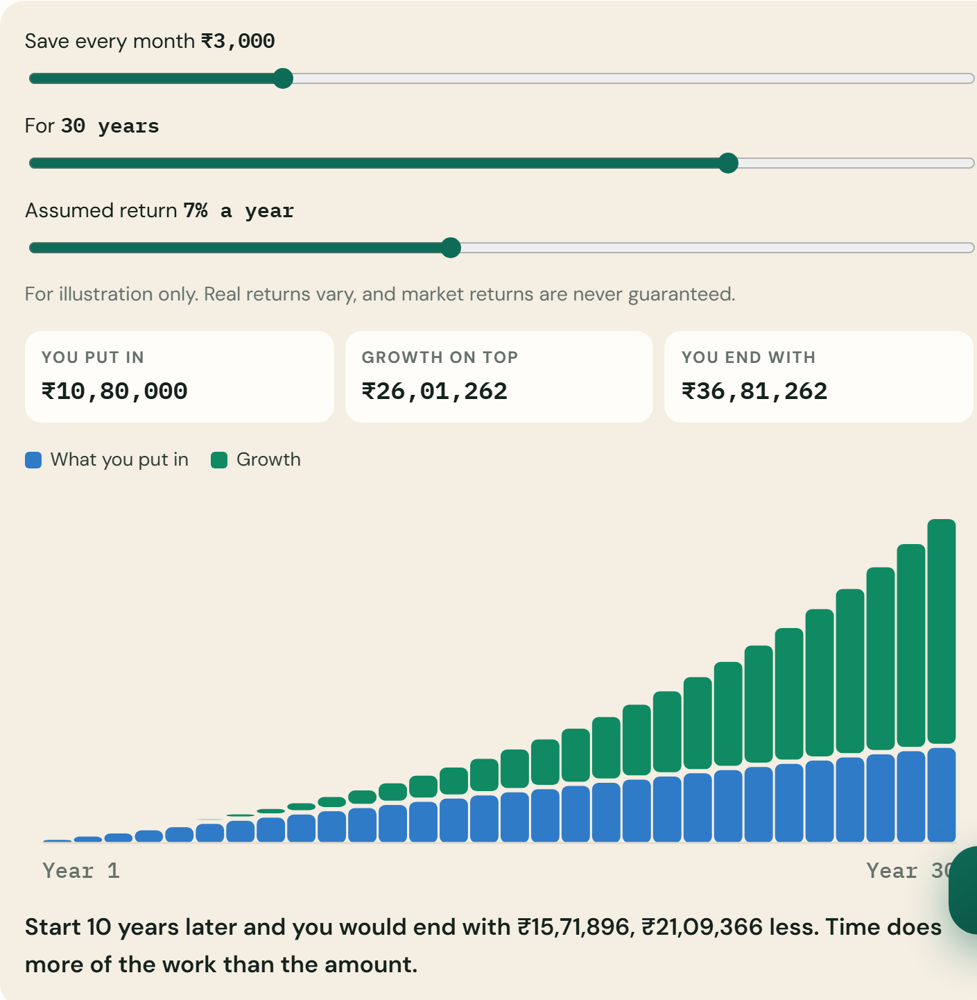</td>
  </tr>
  <tr>
    <td align="center"><sub>Price lab: news moves buyers and sellers</sub></td>
    <td align="center"><sub>Compounding lab: time beats amount</sub></td>
  </tr>
</table>

### What the simulation tracks

- **A calendar** that moves forward as the story does ("three months later").
- **Cash, savings, recurring deposit and shares (at cost)**, with a running net worth.
- **Scheduled auto-debits**: recurring-deposit instalments run automatically and earn monthly interest; a short balance makes an instalment fail.
- **Real consequences for scams**: falling for one debits your simulated savings or moves shares out of your demat account, and the loss stays on your statement.
- **A financial health score (0–100)**: cushion (40) + saving habit (20) + fraud safety (40), shown as *Fragile*, *Building*, *Steady* or *Strong*.
- **XP and levels**, with pop-up feedback whenever money, XP, messages or apps change.
- **A help panel** on every screen, linking to **15 plain-language library articles** (what a share is, demat and depositories, reading your CAS, IPOs the safe way, checking SEBI registration, deepfakes, digital arrest, pension scams, reporting fraud, and more).

### Screen types

| Type | What the learner does |
|---|---|
| Story | Reads a short story beat, often with a mentor |
| Explore | Taps cards to reveal each idea |
| Sort | Puts items into buckets, with instant feedback |
| Order | Taps steps into the right sequence |
| Lab | Plays with a model: the price lab and the compounding lab |
| Decision | Makes a choice with consequences; locked once made |
| Scam autopsy | Taps every red flag in a scam message or call |
| Quiz | Checks understanding, +10 XP per correct answer |
| Phone task | Does something on the virtual phone (verify a broker, open the CAS) |
| Recap | Takeaways, health score, net worth and XP |

---

## The virtual phone

A realistic in-game phone makes the lessons concrete. Apps unlock as the story needs them:

| App | What it does |
|---|---|
| **Messages** | Receives SMS and chats from family, the bank and scammers (who look just as real) |
| **Bank** | Balance, recurring deposit, auto-debits and a full statement |
| **Calculator** | Monthly-deposit growth: what you put in vs what interest adds |
| **Demat** | Holdings and a **CAS statement** in which the player must spot an off-market transfer they never made |
| **Verify** | A simulated **SEBI registration lookup** over fictional entities: "StockGuru Pro" is not registered |

<table>
  <tr>
    <td>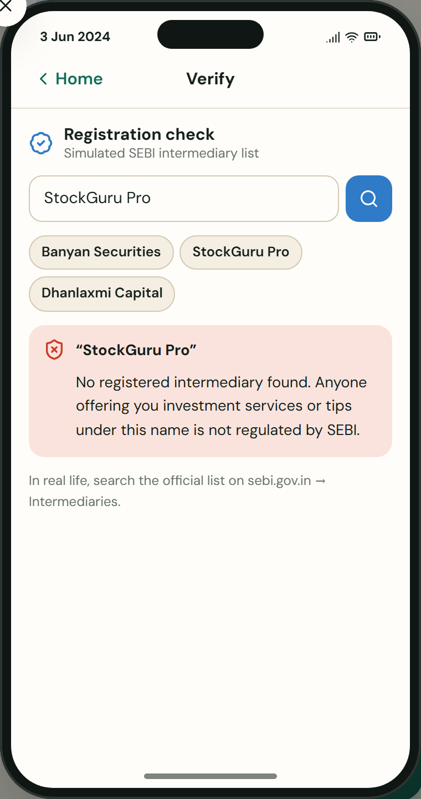</td>
    <td>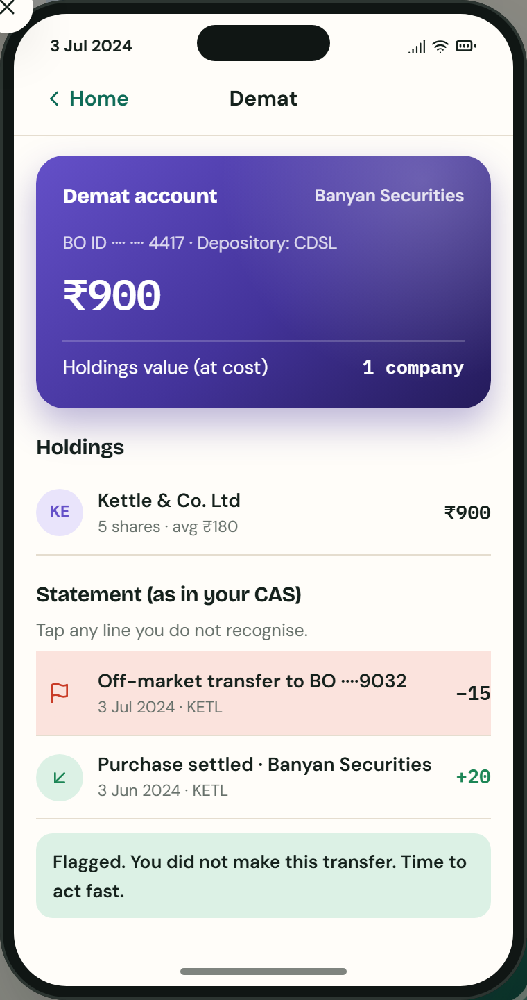</td>
  </tr>
  <tr>
    <td align="center"><sub>Verify: "StockGuru Pro" is not registered</sub></td>
    <td align="center"><sub>CAS: an unauthorised transfer, flagged</sub></td>
  </tr>
</table>

---

## Who it is for

| Audience | What they gain |
|---|---|
| **Senior citizens** | Recognise digital-arrest, pension and impersonation scams; know whom to call |
| **First-time investors**, especially in Tier II+ cities | Practical command of demat accounts, the CAS, IPOs and investor fraud |
| **Students (18–29)** | Resistance to finfluencer tips, fake trading apps and pump-and-dump groups |

**Three learners, three journeys (illustrative)**

- **Kamala, 68, retired teacher:** her grandson forwards *The Pension Call*. She learns to read what an OTP is for. When a real "treasury officer" calls, she hangs up and phones her branch.
- **Rohan, 20, student:** added to a stock-tip group, he plays *The Tip Group* first, checks the "SEBI-registered expert" and exits. Then he challenges his friends.
- **Priya, 29, first-time investor in Indore:** takes the course before opening her demat account, adds a nominee, never shares her TPIN, and now reads every CAS.

---

## Inclusion and accessibility

Already built into the prototype:

- **English and Hindi with one tap**: the home page, all six games and the self-check. Hindi uses Noto Sans Devanagari.
- **Read-aloud**: every chat line, card and result can be spoken in Hindi or English using the browser's own voice, for low-literacy users and seniors.
- **Large-text mode** that scales the whole site.
- **Works on any phone browser**: no install, no sign-up, keyboard focus states, and reduced motion when the device asks for it.
- **Different scenarios for each audience**, so a senior and a student each meet the scams aimed at them.

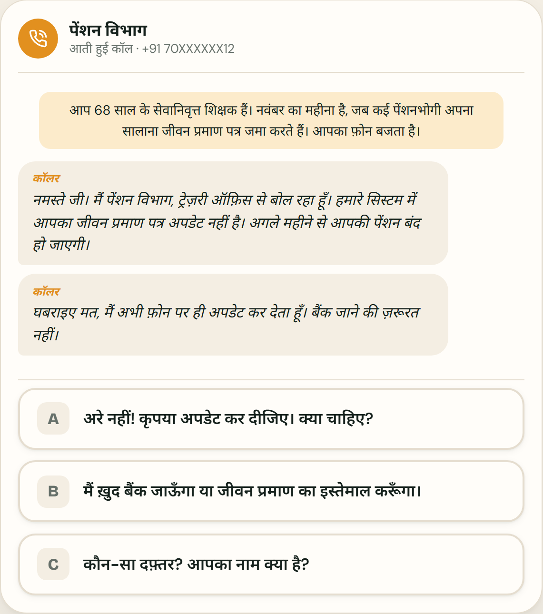

Not yet built: Hindi for the course chapters and library, more regional languages, and a lite mode for slow networks.

---

## Privacy and safety by design

- **Nothing to steal:** no login, no names, no phone numbers. FinSim **never** asks for a PAN, Aadhaar number, OTP, password or account details, and it teaches users to treat any such request as a red flag.
- **Stays on the device:** progress, scores and settings live only in the user's browser (`localStorage`). One button wipes them.
- **Clean sharing:** game links carry only the game's id. The Money DNA share link encodes just the personality type and four scores, with no identity.
- **Measurement without tracking:** the planned validation phase uses anonymous aggregate counts and opt-in surveys, consistent with data minimisation under the **DPDP Act, 2023**.
- **Within the brief's rules:** no investment advice, no trading or transaction execution, no real securities or products promoted (every company, broker, bank and app is fictional), and nothing rewards speculation. Points come from verifying, pausing and reporting, not from picking winners.

---

## Measuring impact

A **before/after self-check** (`/check`) is built in. It uses two equivalent sets of six messages (three scams and three safe in each), so the "after" score measures learning, not memory of the "before" answers. Scores stay in the browser.

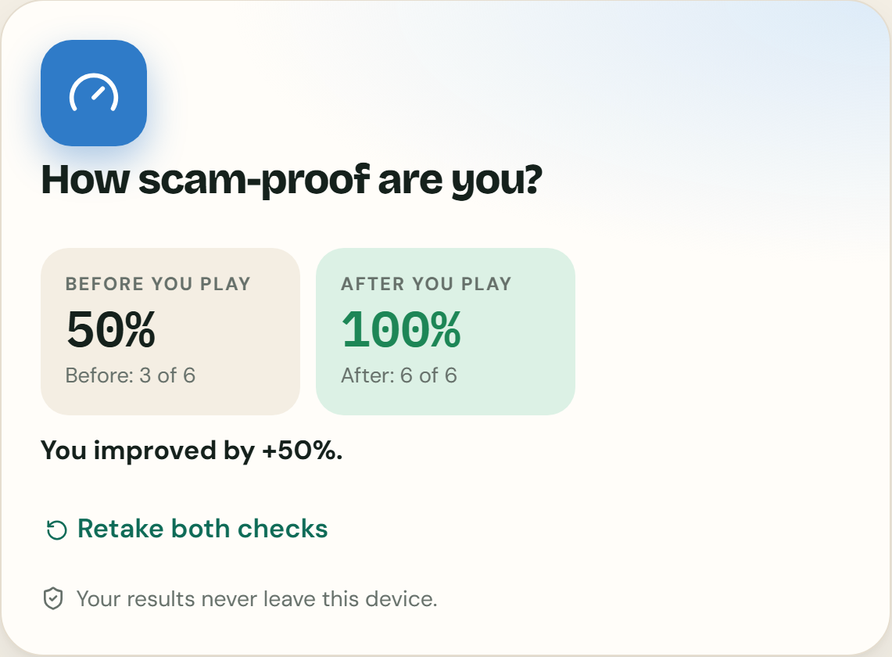

| Outcome | How it is measured |
|---|---|
| Better scam detection | Built-in before/after self-check score |
| Knows the response steps | % who can name 1930 and the account-freeze steps |
| Verification habits | % who check SEBI registration and read their CAS |
| Reach | Plays, completions and shares (anonymous counts) |
| Confidence in markets | Self-reported confidence, before and after |

---

## How FinSim maps to the judging criteria

| Criterion | How FinSim answers it |
|---|---|
| **Innovation** | Securities-native fraud rehearsal: demat, depositories, DPs, CAS, DDPI/TPIN, ASBA and SEBI checks, not generic bank tips. Safe failure: lose virtual savings, then see exactly how it was done. |
| **Functionality (UX/UI)** | A working prototype: two-minute games, one decision at a time, a polished and mobile-first interface. |
| **Behavioural insight** | Rehearsal over reading; consequences you feel; teach first, then test; a debrief after every game. |
| **Feasibility** | Already built as a static web app; content is data, so new scams and languages need no new code. |
| **Viability and scalability** | Near-zero hosting cost, shareable links, and natural channels: DP onboarding, CAS emails, SEBI programmes, colleges. |
| **Accessibility and inclusion** | English + Hindi, read-aloud, large text, any browser, no sign-up, scenarios for each audience. |
| **Data protection and privacy** | No accounts, no personal data, device-only storage, identity-free share links. |
| **Presentation** | Every claim can be checked in the live prototype. |

Values from the problem statement: **Empowerment** (decide, see consequences, learn why; never advice), **Trust** (teaches verification: SEBI registration, CAS as the source of truth, official channels only), **Safety** (learn → recognise → avoid → respond, end to end), **Inclusion** (as above).

---

## Roll-out plan

| Phase | Deliverables |
|---|---|
| **1. Done** | Working prototype: 6 games, 8 chapters, 15 library articles; English + Hindi, read-aloud, large text, before/after self-check |
| **2. Validate** | Real users at 2–3 colleges and a senior citizens' association; impact measured with the built-in self-check; Hindi for the course |
| **3. Scale** | Links in DP onboarding and CAS emails, SEBI programmes, colleges and WhatsApp; more regional languages |

> **Why CDSL is the right channel.** Every investor already receives a CAS. One line in that email ("Can you spot the scam? Play in 2 minutes") could put FinSim in front of millions of demat holders at almost no cost.

---

## Technology and architecture

| Layer | Choice |
|---|---|
| UI | React 18 + TypeScript, built with Vite 6 |
| Routing | React Router 6 (browser routes in development, hash routes on GitHub Pages) |
| State | Zustand, persisted to `localStorage` (simulation, game best scores, settings, self-check) |
| Icons | lucide-react |
| Fonts | Bricolage Grotesque, DM Sans, IBM Plex Mono, Noto Sans Devanagari (Google Fonts) |
| Speech | The browser's built-in Web Speech API (no external service) |
| Hosting | Static files on GitHub Pages; no server, no database |

**Content is data.** Games and course screens are plain TypeScript objects. A small set of generic players and views render them, so adding a scam, a chapter or a translation needs no new components.

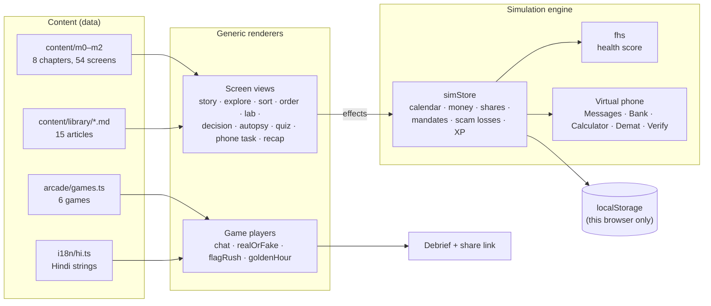

**Effects drive the simulation.** A screen never changes state directly; it lists effects such as `credit`, `debit`, `transfer`, `scamLoss`, `startRd`, `advanceDays`, `buyShares`, `dematDebit`, `message` and `unlockApp`. The engine applies each screen's effects once, even across reloads and replays, so a loss is never charged twice.

### Routes

| Route | Page |
|---|---|
| `/` | Landing page: the course and all six games |
| `/arcade/:gameId` | One scam game (`digital-arrest`, `pension-call`, `real-or-fake`, `tip-group`, `red-flag-rush`, `golden-hour`) |
| `/learn` | Journey map of the investor course |
| `/play/:moduleId/:chapterId/:screenId` | The course player |
| `/check` | Before/after self-check |
| `/library`, `/library/:slug` | Library articles |
| `/dna/s/:token` | A shared Money DNA result |

On the live site, routes live after a `#`, for example `https://ayediti.github.io/cdsl-ideathon/#/arcade/digital-arrest`.

---

## Repository layout

```
cdsl-ideathon/
├── README.md                  ← you are here
├── app/                       ← the web app
│   ├── README.md              ← engine and content reference for developers
│   ├── index.html
│   ├── package.json
│   ├── vite.config.ts
│   ├── .env.pages             ← VITE_ROUTER=hash for the GitHub Pages build
│   └── src/
│       ├── App.tsx, main.tsx  ← routes and router choice
│       ├── brand.ts           ← product name, tagline, fictional bank and broker names
│       ├── arcade/            ← the six games: data (games.ts) + players + debrief + share bar
│       ├── content/           ← course modules (m0–m2) and library/*.md articles
│       ├── engine/            ← simulation store, curriculum, health score, dates, Money DNA
│       ├── screens/           ← generic screen views (explore, sort, order, labs, quiz, …)
│       ├── phone/             ← virtual phone and its apps, fictional SEBI registry
│       ├── check/             ← before/after self-check items and store
│       ├── i18n/              ← Hindi strings, translate hook, read-aloud, settings
│       ├── components/        ← HUD, score ring, toasts, help panel, accessibility controls
│       ├── pages/             ← Landing, Learn (journey map), Player, ArcadePage, SelfCheck, Library
│       └── styles.css         ← design tokens, layout, components, large-text mode
└── submission/
    ├── finsim_submission.tex  ← the 3-page screening-round paper (LaTeX)
    └── *.png                  ← real screenshots of the prototype used in the paper and this README
```

---

## Run it locally

Requires **Node.js 20+** (developed on Node 22).

```bash
cd app
npm install
npm run dev          # http://localhost:5173
```

Other scripts:

| Command | What it does |
|---|---|
| `npm run typecheck` | TypeScript check only |
| `npm run build` | Type-check + production build into `app/dist/` (browser routes) |
| `npm run preview` | Serve the production build locally |
| `npm run build:pages` | Type-check + build into `app/dist-pages/` with hash routes and relative paths, for GitHub Pages |

To start fresh, use **Reset** in the app, or clear the site's storage in your browser.

---

## Deploy to GitHub Pages

The live site is served from the **`gh-pages`** branch, which holds only the built site, never source (repo **Settings → Pages → Deploy from a branch → `gh-pages` / root**). GitHub Pages only serves real files, so the Pages build uses hash routes: refreshing a page or opening a shared link never returns a 404.

```bash
cd app
npm run build:pages

# publish app/dist-pages/ to the gh-pages branch
cd ..
git worktree add ../finsim-pages gh-pages
rm -rf ../finsim-pages/*
cp -r app/dist-pages/. ../finsim-pages/
touch ../finsim-pages/.nojekyll
cd ../finsim-pages
git add -A
git commit -m "Deploy site"
git push origin gh-pages
cd -
git worktree remove ../finsim-pages
```

---

## Extend it

Detailed developer notes are in [`app/README.md`](app/README.md). In short:

- **Add a scam game:** add an object to [`app/src/arcade/games.ts`](app/src/arcade/games.ts) using one of the existing kinds (`chat`, `realOrFake`, `flagRush`, `goldenHour`). It gets the debrief and share bar for free.
- **Add a course chapter:** add a `Chapter` to a module in [`app/src/content/`](app/src/content), list its screen ids in `screenSequence`, and define each screen. If it depends on earlier chapters, give it an `entry` list of `ensure*` effects.
- **Add a library article:** drop a Markdown file into [`app/src/content/library/`](app/src/content/library) and link it from a screen's `help.links`.
- **Add or improve a translation:** map English strings to Hindi in [`app/src/i18n/hi.ts`](app/src/i18n/hi.ts); `useT()` falls back to English for anything missing.
- **Rename the product:** change [`app/src/brand.ts`](app/src/brand.ts) and the `<title>` in [`app/index.html`](app/index.html).

In development, a missing screen id or a red-flag snippet that does not appear in its message is logged as an error in the browser console.

---

## The submission paper

[`submission/finsim_submission.tex`](submission/finsim_submission.tex) is the three-page screening-round entry (About the Idea; Challenges, Risks & Assumptions; Impact; Try the Prototype). To compile it, upload the `.tex` file and every `.png` in `submission/` to **Overleaf** and build with **pdfLaTeX**. A missing image is replaced by a labelled placeholder, so it compiles either way. Every image is a real screenshot of the prototype.

---

## Disclaimer

FinSim is an educational simulation. All companies, banks, brokers, apps, people and messages in it are **fictional**, and all money is virtual. It does not provide investment advice, does not enable trading or transactions, does not promote any financial product, and never connects to a real bank, broker or demat account.

If you have been targeted by a real fraud in India, call **1930** or report it at **[cybercrime.gov.in](https://cybercrime.gov.in)**, contact your bank or broker through their official channels, and for securities-market complaints use **[SEBI SCORES](https://scores.sebi.gov.in)**.
